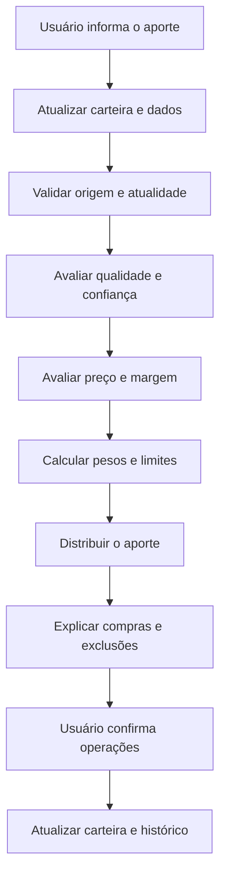

# Escopo do produto e do MVP — motor interpretativo de aportes

Versão 1.0 · 16/09/2026 · Documento de visão e delimitação de produto

## 1. Visão do produto completo

A ferramenta será um sistema pessoal de apoio à decisão para investidores de longo prazo. Seu propósito é transformar dados financeiros, uma política de investimento explícita e a composição atual da carteira em recomendações mensais de aporte que sejam reproduzíveis, explicáveis e coerentes com os objetivos do investidor.

O usuário informa quanto tem disponível para investir. O sistema atualiza os dados dos ativos acompanhados, avalia qualidade, preço, confiança das informações e contribuição para a carteira, calcula quais ativos podem receber capital e propõe quantidades compatíveis com o orçamento. A recomendação explica por que cada ativo recebeu ou não recebeu aporte.

O produto não procura prever oscilações de curto prazo. Sua lógica se inspira na abordagem apresentada em *O jeito Warren Buffett de investir*: tratar ações como participações em negócios, priorizar qualidade econômica, geração sustentável de caixa, gestão e alocação racional de capital, pagar um preço coerente e manter margem para erros de estimativa.

Esses princípios são adaptados para ações, FIIs e ETFs. As regras numéricas, pesos, limites e modelos de avaliação são uma política própria e versionada; não são apresentados como regras estabelecidas por Warren Buffett.

## 2. Problema que a ferramenta resolve

O investidor recebe informações dispersas: cotações, múltiplos, balanços, proventos, relatórios gerenciais, composição de fundos e opiniões de terceiros. Mesmo quando possui uma estratégia, pode ter dificuldade para transformá-la em uma decisão mensal consistente.

As perguntas centrais são:

- Qual ativo da carteira merece receber o aporte deste mês?
- Quanto direcionar para cada ativo considerando o valor disponível?
- O ativo está saudável e com preço aceitável, ou apenas parece barato?
- A compra melhora a distribuição da carteira ou aumenta uma concentração indesejada?
- Por que um ativo foi escolhido e outro ficou de fora?
- A política está sendo aplicada da mesma maneira ao longo do tempo?

A ferramenta organiza esse processo em um motor de decisão determinístico. A mesma versão das regras e os mesmos dados devem produzir o mesmo resultado, permitindo examinar e contestar cada etapa.

## 3. Público inicial e contexto de uso

O usuário inicial é o próprio criador da ferramenta, investidor pessoa física com horizonte de longo prazo, perfil arrojado e objetivos de aposentadoria, crescimento de renda passiva real e valorização patrimonial. A carteira combina Brasil e exterior e contém ações, FIIs e ETFs.

A carteira inicial de desenvolvimento contém uma unidade de cada ativo:

| Classe | Ativos iniciais |
|---|---|
| Ações brasileiras | ITUB4, BBSE3, WEGE3 e ABEV3 |
| FIIs | HGLG11, KNCR11 e XPML11 |
| ETFs | IVVB11 e SCHD |

Essa lista inicia a implementação e valida a existência de perfis distintos. Ela não representa uma recomendação permanente nem impede a inclusão futura de outros ativos qualificados.

## 4. Proposta de valor

A ferramenta entrega uma decisão mensal em linguagem direta:

> “Com R$ 1.000 disponíveis, compre X unidades do ativo A e Y unidades do ativo B. O ativo A combina qualidade, preço aceitável e déficit em relação ao peso desejado. O ativo B melhora a diversificação da carteira. Os demais ativos não receberam aporte pelos motivos registrados abaixo.”

O valor principal não está apenas na lista de compras. Está na combinação de:

1. **Disciplina:** a decisão segue uma política definida antes de observar o resultado desejado.
2. **Contexto:** indicadores são interpretados conforme o segmento e o tipo de ativo.
3. **Proximidade gradual:** o ativo não precisa igualar exatamente um número-alvo; quanto mais próximo das faixas desejáveis, melhor sua nota.
4. **Separação entre qualidade e preço:** múltiplo baixo não compensa risco grave ou negócio ruim.
5. **Carteira como sistema:** uma boa empresa pode não receber aporte se estiver cara ou concentrada.
6. **Explicabilidade:** dados, regras, notas, bloqueios e quantidades permanecem rastreáveis.
7. **Prudência:** o sistema pode recomendar manter parte ou todo o dinheiro em caixa quando não houver compra aceitável.

## 5. Fluxo do produto completo



Gerar uma proposta e confirmar uma compra são operações distintas. O sistema somente atualiza posições depois que o usuário registra ou importa a execução real, com quantidade, preço e custos efetivos.

## 6. Núcleo interpretativo

O motor avalia quatro dimensões separadas:

| Dimensão | Pergunta |
|---|---|
| Qualidade | O ativo apresenta fundamentos compatíveis com seu segmento e com a política? |
| Confiança | Os dados são completos, atuais, rastreáveis e consistentes? |
| Preço | O preço oferece retorno esperado e margem de segurança adequados? |
| Carteira | A compra respeita pesos, diversificação, limites e orçamento? |

As regras são configuradas por perfil econômico. Bancos não usam a mesma régua de indústrias; FIIs de tijolo não usam a mesma régua de FIIs de papel; ETFs não recebem o ROIC de uma empresa.

O sistema utiliza funções contínuas de pontuação. Por exemplo, se a nota máxima de um indicador começa em 3 pontos percentuais e o ativo apresenta 2,5, ele recebe nota próxima da máxima, sem reprovação por não atingir exatamente o alvo. Condições críticas continuam sendo eliminatórias.

O resultado de cada ativo pode ser:

- **Elegível pleno:** pode receber aporte se preço e carteira permitirem.
- **Elegível condicional:** pode receber aporte limitado em posição existente.
- **Manter sem aporte:** tese preservada, mas compra não é indicada no momento.
- **Observação:** dados ou fundamentos exigem investigação.
- **Revisar saída:** deterioração persistente ou quebra confirmada de tese; nunca gera venda automática.

## 7. Escopo do produto completo

### 7.1 Gestão da carteira

- Cadastrar posições iniciais, moedas, quantidades, preços e custos.
- Registrar compras, vendas, proventos e aportes.
- Importar operações quando houver integração confiável disponível.
- Calcular valor de mercado, custo, exposição por classe, setor, moeda e grupo econômico.
- Distinguir patrimônio aportado, resultado dos investimentos e renda recebida.

### 7.2 Integração de dados

- Obter preços, câmbio, demonstrações financeiras e indicadores por APIs.
- Capturar informações complementares de fontes oficiais e documentos.
- Registrar origem, unidade, período econômico, publicação, coleta e ajustes.
- Detectar dados ausentes, vencidos, conflitantes ou alterados pelo fornecedor.
- Preservar snapshots usados em cada recomendação.

### 7.3 Avaliação de ativos

- Aplicar perfis distintos para ações, bancos, seguradoras, holdings, FIIs de tijolo, FIIs de papel e ETFs.
- Calcular qualidade, confiança, múltiplos e estados de elegibilidade.
- Receber ou calcular cenários de valuation com premissas explícitas.
- Avaliar renda recorrente, cobertura e crescimento real dos pagamentos.
- Permitir revisão qualitativa documentada de gestão, vantagem competitiva e riscos.

### 7.4 Recomendação mensal

- Receber qualquer valor positivo de aporte em reais.
- Considerar caixa e proventos efetivamente liberados para reinvestimento.
- Distribuir o orçamento por déficits de classe e prioridades dentro de cada classe.
- Respeitar preço-limite, concentração, custos, moedas e unidades negociáveis.
- Informar compras, quantidades, custos estimados e saldo não utilizado.
- Explicar escolhas, limitações e exclusões.

### 7.5 Confirmação e histórico

- Salvar cada proposta com versão da política e snapshot das entradas.
- Permitir confirmar, ajustar ou rejeitar a proposta.
- Atualizar a carteira somente com operações realmente executadas.
- Comparar recomendação, execução e resultado sem reescrever o passado com regras novas.

### 7.6 Revisão periódica

- Reavaliar semestral ou anualmente as teses e a alocação desejada.
- Identificar ativos que deixaram de atender aos princípios.
- Priorizar rebalanceamento por novos aportes.
- Simular vendas somente quando concentração ou quebra de tese justificar análise adicional.
- Considerar custos e regras tributárias atuais antes de propor redução.

### 7.7 Dashboard

- Patrimônio total e evolução no tempo.
- Aportes acumulados versus resultado dos investimentos.
- Alocação por classe, ativo, setor, moeda e país.
- Proventos recebidos e renda recorrente estimada.
- Crescimento real da renda e do patrimônio.
- Histórico de recomendações e operações confirmadas.
- Estado atual das teses, pendências de dados e próxima revisão.

## 8. Recorte do MVP atual

O MVP valida a tese técnica central: **um motor consegue transformar uma política explícita, uma carteira e um valor de aporte em uma proposta determinística e explicável?**

Nesta primeira implementação, o sistema funcionará com dados fictícios e uma data de análise fixa. Ele será executável pelo terminal e pelo navegador. As duas interfaces compartilharão o mesmo motor.

### 8.1 Funcionalidades incluídas

- Carteira fictícia com os nove ativos iniciais e uma unidade de cada.
- Aporte variável informado pelo usuário.
- Cenários controlados de mercado e fundamentos.
- Validação dos dados e das configurações.
- Pontuação gradual por perfil.
- Cálculo de qualidade e confiança.
- Valuation fornecido como fixture, múltiplos, margem e teto de compra.
- Estados de elegibilidade e bloqueios.
- Cálculo de pesos atuais, futuros e déficits.
- Distribuição em unidades inteiras, respeitando orçamento, custos e limites.
- Proposta com compras, exclusões, razões e saldo.
- Interface web responsiva para simular e explorar a decisão.
- CLI para executar cenários e exportar JSON.
- Aviso permanente de que os dados são fictícios e nenhuma compra é executada.

### 8.2 Cenários disponíveis no navegador

- Cenário padrão.
- Todos os ativos inelegíveis.
- Dados incompletos.
- Concentração excessiva.
- Atalhos para aportes de R$ 500 e R$ 1.000, além de valor livre.

Os testes cobrirão ainda preços acima do teto, lucro negativo, dados vencidos, orçamento insuficiente, custos e câmbio, empate determinístico, classe sem candidato, entrada alterada durante o cálculo e falhas de exportação.

### 8.3 Interface do MVP

A tela principal terá:

1. Campo para o valor do aporte e escolha do cenário.
2. Resumo com orçamento, compras, custos e saldo.
3. Tabela com ativos, quantidades, preço simulado e total.
4. Painel “Por trás da escolha”, com indicadores, faixas e notas.
5. Lista dos ativos sem aporte e seus motivos.
6. Comparação entre pesos atuais, simulados e alvos.
7. Download do snapshot da proposta em JSON.

A alteração do valor ou do cenário torna a proposta anterior desatualizada até nova execução. A carteira permanece somente para leitura.

### 8.4 Limitações deliberadas do MVP

- Dados fictícios, sem consulta a APIs ou documentos de mercado.
- Valores intrínsecos fornecidos como premissas de teste, sem projeções automáticas.
- Nenhum login, conta compartilhada ou sincronização entre dispositivos.
- Nenhum banco de dados ou histórico durável de operações.
- Nenhuma execução de ordem ou integração com corretora.
- Nenhuma atualização automática da carteira.
- Nenhuma IA generativa na decisão ou na justificativa.
- Nenhum dashboard histórico ou cálculo de rentabilidade real.
- Nenhuma revisão periódica automatizada.
- SCHD participa da valoração da carteira, mas não recebe recomendação de compra até o perfil específico de ETF de dividendos ser implementado.

## 9. Arquitetura do MVP

Uma única aplicação TypeScript será suficiente:

```text
Interface React ─┐
                 ├─ Caso de uso de simulação ─ Motor determinístico
CLI local ───────┘                              │
                                               ├─ política versionada
Fixtures validadas ────────────────────────────┤
                                               └─ proposta e evidências
```

- O domínio contém cálculos puros e não conhece React, arquivos ou rede.
- A aplicação coordena avaliação, alocação e explicação.
- Adaptadores leem fixtures e exportam JSON.
- React e CLI apresentam o mesmo resultado.
- Valores monetários usam representação exata em centavos ou decimal apropriado.
- Data, política e snapshots são entradas explícitas para garantir reprodução.

O projeto seguirá TDD para cálculos, validações e interações. Mudanças puramente visuais serão verificadas por inspeção e build, conforme o manual de engenharia.

## 10. Critérios de sucesso do MVP

O MVP estará pronto quando:

- R$ 500 e R$ 1.000 produzirem propostas completas, potencialmente diferentes, baseadas nas mesmas regras.
- O sistema nunca ultrapassar o orçamento nem os limites aplicáveis.
- Cada compra e exclusão tiver uma justificativa derivada dos cálculos.
- Entradas iguais produzirem o mesmo resultado no terminal e no navegador.
- Dados ausentes, inválidos ou vencidos não se transformarem em aprovação silenciosa.
- A ausência de compra preservar o dinheiro como saldo válido.
- Gerar ou exportar proposta não modificar a carteira.
- Os cenários de aceitação, testes, tipagem, lint e build aplicáveis passarem.
- Outra pessoa conseguir instalar, executar e reproduzir os exemplos pela documentação.

O sucesso do MVP comprova o fluxo e a integridade da lógica em ambiente controlado. Ele não comprova que as faixas financeiras geram retorno superior, que os dados de mercado são confiáveis ou que uma recomendação deve ser usada com dinheiro real.

## 11. Evolução após o MVP

| Fase | Entrega principal | Risco que precisa ser resolvido |
|---|---|---|
| 1 — Motor fictício | Decisão determinística e explicável | Correção matemática e coerência das regras |
| 2 — Dados reais em leitura | Preços e métricas atualizados por API | Contrato, atualidade, divergência e mudanças do fornecedor |
| 3 — Carteira persistida | Operações confirmadas e histórico | Integridade, atomicidade, identidade e recuperação |
| 4 — Valuation assistido | Premissas e cenários calculados | Incerteza, comparabilidade e supervisão humana |
| 5 — Dashboard | Evolução patrimonial e renda | Qualidade histórica, proventos, câmbio e tributação |
| 6 — Revisão periódica | Rebalanceamento e saúde das teses | Venda, custo fiscal, quebra de tese e versionamento |
| 7 — Produto multiusuário | Políticas e carteiras pessoais | Autorização, privacidade, isolamento e adequação regulatória |

A primeira integração real deve substituir o adaptador de fixtures sem reescrever o motor. O resultado histórico continua associado aos dados e à política utilizados na época.

## 12. Possível direção comercial futura

Depois de resolver o problema pessoal e acumular histórico de uso, a ferramenta pode evoluir para um produto voltado a investidores que desejam seguir uma política própria de longo prazo, sem depender de recomendações genéricas baseadas somente em dividend yield ou múltiplos isolados.

Uma versão comercial precisaria testar demanda, clareza de posicionamento, confiança dos usuários e limites regulatórios antes de apresentar recomendações personalizadas. Também exigiria isolamento entre usuários, proteção de dados, trilha de decisão, termos apropriados e uma definição clara entre ferramenta educacional, análise e aconselhamento financeiro.

Essa direção não faz parte do compromisso atual de implementação. O MVP existe para provar o motor, desenvolver experiência prática em software e gerar evidência de que a decisão explicável é útil no uso recorrente.

## 13. Fontes de verdade do projeto

| Documento | Papel |
|---|---|
| `ESCOPO_PRODUTO_MVP.md` | Define visão, fronteira do MVP e evolução pretendida |
| `Politica_Decisao_Motor_Investimentos_v1.md` | Define critérios financeiros e algoritmo de decisão |
| `GRAFO_DEPENDENCIAS.md` | Define arquitetura, dependências e marcos de implementação |
| `TASK.md` | Define requisitos, contratos, tarefas, cenários e conclusão |
| `AGENTS.md` | Define regras obrigatórias para o agente implementador |
| `docs/DECISAO_FONTES_DADOS.md` | Registra roteamento provisório de fontes externas e gates de homologação |
| `MANUAL_PADRAO_ENGENHARIA.md` | Define práticas comuns de engenharia, TDD, segurança e integridade |
| `PERFIS_PROJETOS_SISTEMAS_DISTRIBUIDOS.md` | Especializa o projeto como P3, com complemento P1 |

Em caso de mudança de escopo, este documento, o grafo e o TASK devem ser revisados juntos. Mudanças na lógica financeira exigem nova versão da política e não podem ser introduzidas apenas para favorecer um ativo específico.
