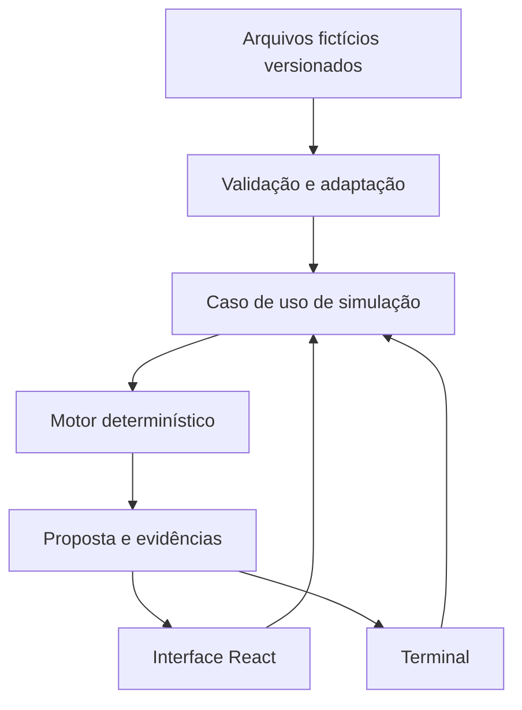
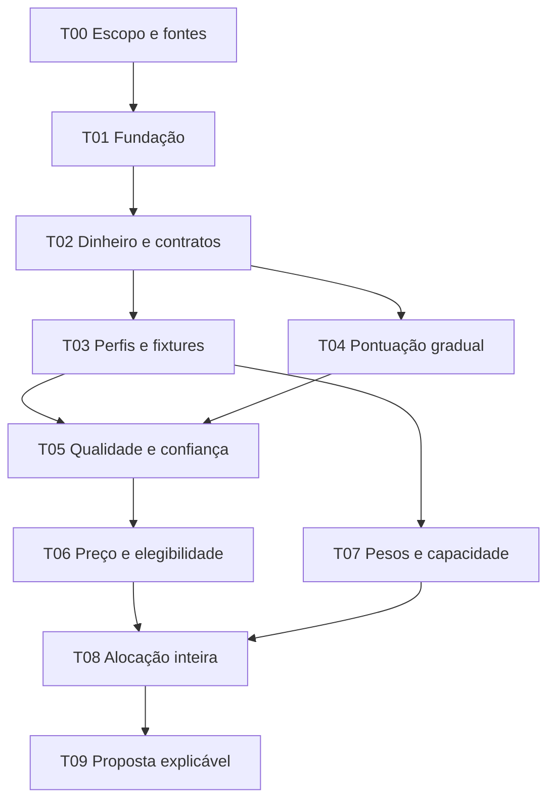
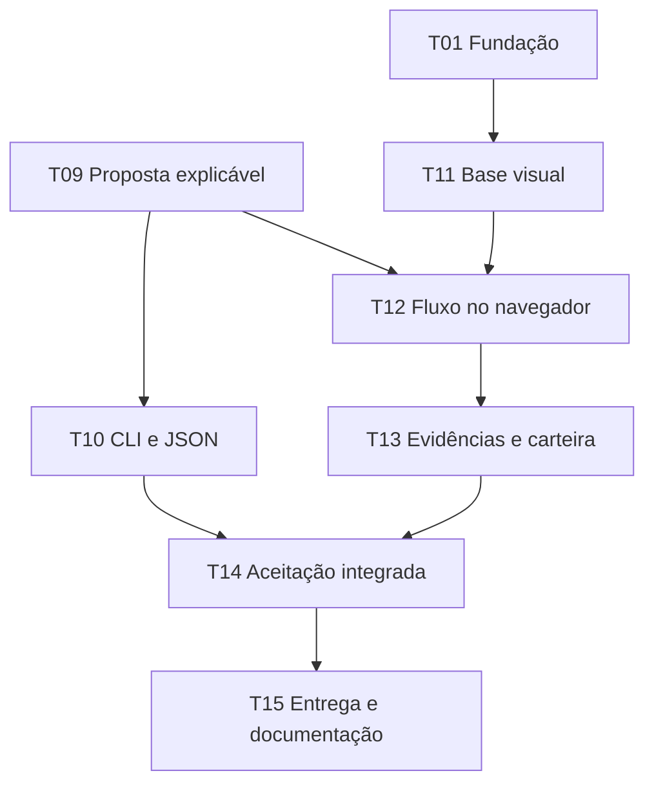

# Grafo de dependências — motor de aportes com dados fictícios

Versão 2.3 · 25/09/2026 · Estado: T00–T15 concluídas.

## 1. Objetivo e referências

Entregar uma aplicação local que recebe um aporte variável em reais, avalia os nove ativos cadastrados com dados fictícios, propõe unidades inteiras, explica compras e exclusões e permite inspecionar o resultado no navegador e pelo terminal. Gerar proposta nunca registra uma compra.

Arquivos deste pacote, destinados à mesma pasta na raiz do futuro projeto:

- `GRAFO_DEPENDENCIAS.md`: dependências e arquitetura planejada.
- `TASK.md`: requisitos, contratos e tarefas com critérios de aceitação.
- `AGENTS.md`: regras para o agente implementador.

Fontes fornecidas e lidas nesta revisão: política do motor v1.0, `MANUAL_PADRAO_ENGENHARIA(1).md` v1.0 e `PERFIS_PROJETOS_SISTEMAS_DISTRIBUIDOS(2).md` v1.0. T00 organiza cópias em `docs/`, com os nomes canônicos registrados no AGENTS. Manual é a base comum; perfis P3/P1 especializam as garantias nas fronteiras existentes. Não ativar perfis inativos por simples presença no catálogo.

Esta revisão incorpora o manual à implementação, aos testes e aos gates. Não altera as faixas financeiras nem amplia o produto com serviços externos.

Escopo mais recente prevalece: a interface web agora integra a primeira entrega, além do terminal. API real, persistência de posições, ordens, IA, dashboard histórico e rebalanceamento periódico ficam fora desta fase.

## 2. Arquitetura mínima

Um projeto TypeScript organizado em `frontend/` (React/Vite) e `backend/` (domínio, aplicação, adaptadores, fixtures e CLI local). A pasta `backend/` contém o motor executado no mesmo processo; não representa um serviço HTTP nem uma API. O navegador e a CLI usam o mesmo caso de uso. Sem backend de negócio remoto, PostgreSQL, Redis, Docker obrigatório ou serviços distribuídos.

As setas acima representam fluxo de dados, não dependências de importação. Importações devem seguir: UI/CLI → aplicação → domínio; adaptadores implementam contratos definidos pela aplicação/domínio. Domínio não importa UI, Node, browser, filesystem, rede nem relógio global. Um backend transacional será uma decisão posterior quando houver posições reais persistidas.

## 3. DAG de implementação

Uma seta Txx → Tyy significa que Tyy só pode ser concluída após Txx. A tabela da seção 4 é a fonte exata das dependências; os diagramas dividem o grafo para facilitar leitura.

## 4. Dependências exatas e entregáveis

| Tarefa | Dependências diretas | Entregável |
|---|---|---|
| T00 | Nenhuma | Três fontes normativas organizadas, aplicabilidade e decisões da fase |
| T01 | T00 | Projeto, ferramentas, scripts, revisão de dependências e lockfile verificados |
| T02 | T01 | Contratos de dados, dinheiro/câmbio e validação |
| T03 | T02 | Perfis aplicáveis, configurações e cenários fictícios |
| T04 | T02 | Funções contínuas H/L/B e evidências de nota |
| T05 | T03, T04 | Qualidade e confiança por perfil |
| T06 | T05 | Valuation fornecido, teto e elegibilidade |
| T07 | T03 | Pesos, déficits e limites de capacidade |
| T08 | T06, T07 | Distribuição determinística com unidades e custos |
| T09 | T08 | Caso de uso, justificativas e contrato de saída |
| T10 | T09 | CLI e exportação JSON reproduzível |
| T11 | T01 | Tokens e componentes visuais básicos |
| T12 | T09, T11 | Formulário, cenários e resultados reais do motor |
| T13 | T12 | Detalhamento, exclusões, pesos e download |
| T14 | T10, T13 | Aceitação, testes negativos, diagnóstico, inspeção visual e gates do manual |
| T15 | T14 | README de execução, limitações e entrega reproduzível |

T03/T04, T06/T07 e T11 podem avançar de forma independente depois de suas dependências. Isso indica apenas independência técnica; não exige múltiplos agentes, serviços ou branches. Ordem linear sugerida: T00 a T15.

## 5. Marcos verificáveis

| Marco | Tarefas exigidas | Evidência |
|---|---|---|
| M0 — Fundação | T00–T03 | Configuração coerente e fixtures validadas; comandos registrados |
| M1 — Avaliação | T04–T06 | Indicadores → notas → decisões, com lacunas e restrições |
| M2 — Simulação local | T07–T10 | R$ 500/R$ 1.000 no terminal; budget fechado; JSON |
| M3 — Navegador | T11–T13, mais M2 | Mesmas decisões do CLI, exploração das evidências |
| M4 — Entrega | T14–T15 | Gates passam; cópia isolada reproduz instalação, testes, builds e CLI. `docs/ENTREGA_T15.md` registra a limitação de não haver commit Git rastreável para clone publicado. |

Nenhum marco autoriza uso real de recomendações. Dados são fictícios, valuation é fornecido e SCHD permanece sem recomendação de compra nesta fase.

## 6. Dependências de dados

| Decisão | Dados indispensáveis | Falta/invalidade |
|---|---|---|
| Patrimônio e pesos | Quantidades, preços e câmbio de todas as posições | Erro global; não calcular pesos incompletos como definitivos |
| Qualidade | Métricas por perfil, histórico ou agregados rastreáveis, rubricas | Aplicar cobertura/confiança; não fabricar aprovação |
| Preço de ações/FIIs | Cenários fornecidos e múltiplos válidos | Bloquear aporte do ativo; preço inconclusivo |
| Compra de ETF amplo | Mandato, Q/C, execução e déficit | Bloquear se condição não atendida; não declarar subjacente barato |
| Compra de SCHD | Perfil de dividendos ainda não implementado | `UNSUPPORTED_PURCHASE_PROFILE`; ainda participa da carteira |
| Quantidades | Orçamento, capacidade, unidade, preço reservado e custos | Não emitir compra se custo ou capacidade for insuficiente |
| Explicação | Evidências retornadas pelo domínio | Falha de consistência se texto não corresponde ao cálculo |

## 7. Complexidade adiada e gatilhos

| Mecanismo | Adiado porque | Reconsiderar quando |
|---|---|---|
| API de mercado e retries | Dados locais bastam ao teste | Integrar provedor com contrato de erros e atualidade |
| Banco, autenticação e idempotência durável | Não existe escrita financeira nem conta remota | Registrar compras reais ou compartilhar contas |
| Worker, filas e agendador | Não há processamento durável assíncrono | Criar sincronização/revisão automática |
| LLM | Evidências e textos determinísticos bastam | Interpretar relatórios com validação e supervisão |
| Dashboard histórico | Não existe histórico confiável de transações | Importar operações e definir rentabilidade |
| Rebalanceamento semestral/anual | Agora só alocamos aportes | Definir revisão de teses e vendas com custos/tributos |
| Web Worker | Nove ativos são uma carga pequena | Medição mostrar bloqueio perceptível da interface |

## 8. Regra de manutenção

Alterações de dependência devem atualizar este arquivo e `TASK.md` na mesma mudança. Não marcar tarefa concluída apenas porque a tela parece pronta. O protótipo anterior usava dois ativos e uma divisão ilustrativa: não é oráculo de algoritmo, carteira, preços ou resultados.

## 9. Dependências normativas do manual

A organização das três fontes é predecessora de qualquer implementação. As regras abaixo atravessam as tarefas já existentes, sem criar serviço ou etapa cerimonial adicional.

| Regras | Aplicação atual | Tarefas |
|---|---|---|
| ENG-01/02, COD-01/02, ARQ-01/02 | Escopo, leitura de código, reutilização, menor solução e diff | T00–T15 |
| TDD-01–05 | Red real, bugs/caracterização, nível de teste e exceções delimitadas | T01–T15 conforme mudança |
| COD-03, SEG-01/02/03/04 | Tipos e validação, dependências, conteúdo não confiável, segredos e erros | T01–T03, T09–T14 |
| DAD-01/04, P3-01–05 | Precisão, semântica temporal, snapshot e ausência de efeitos reais | T02–T10, T13–T14 |
| DAD-02/03, DIST-05/06 | Proteção local de exportação quando aplicável; sem transação financeira | T10, T14 |
| PERF-01, DIST-09 | Limitar inputs, garantir término e medir carga real | T02, T08, T14 |
| OPS-02/03 | Erros diagnosticáveis, versões, execução reproduzível e recuperação local | T09–T10, T14–T15 |
| Seções 11/12 do manual | Gates proporcionais, pendências, N/A e exceções | Todas |

Banco, autorização entre contas, backup de dados reais, migrações e recuperação de serviços remotos são N/A nesta fase por inexistência dessas fronteiras; não são dispensas de requisitos para uma futura versão com essas capacidades. HTTP usado para servir a aplicação local não autoriza implementar API de negócio ou endpoints públicos.

Integridade de exportação exige arquivo completo e ausência de sobrescrita silenciosa. Temp+rename isoladamente não assegura exclusão mútua ou proteção contra sobrescrita em todos os sistemas: T10 deve definir mecanismo local de publicação e testar concorrência relevante. Não há promessa de durabilidade contra perda de energia sem mecanismo verificado.
