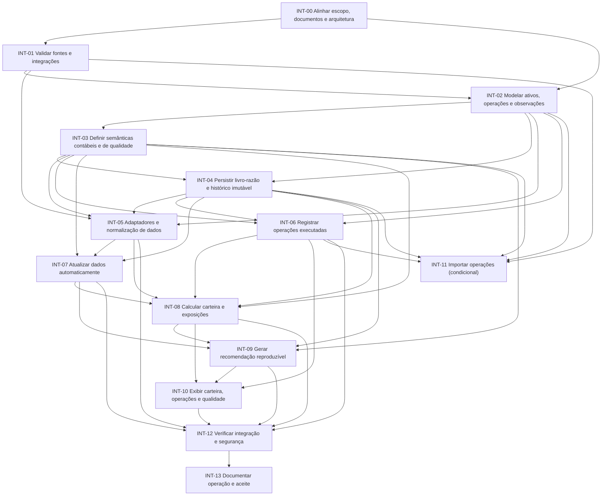

# Grafo de dependências — gestão da carteira e integração de dados

Versão 1.2 · 31/10/2026  
Status: plano proposto; todas as entregas pendentes  
Escopo: evolução do motor de aportes nos requisitos 7.1/7.2, sem envio de ordens

Alterações 1.2: reforço de regras de engenharia com invariantes prescritivas (estados parciais ilegais, identidade estável, precisão de timestamps) e obrigatoriedade de casos negativos no TDD.

## 1. Objetivo e limites

Planejar a evolução do produto completo nos itens **7.1 Gestão da carteira** e **7.2 Integração de dados** do `ESCOPO_PRODUTO_MVP.md`: manter um registro confiável das posições e operações realizadas; calcular valor, custo, exposição, resultado e renda; obter dados externos rastreáveis; e reproduzir recomendações com os mesmos dados e regras usados originalmente.

Este plano é uma fase posterior ao simulador com fixtures. O sistema continua pessoal/single-player e não executa ordens. Operações reais podem ser registradas manualmente depois de executadas; importação de extratos/operações é condicional à existência de uma fonte confiável e nunca confirma operações ou altera a carteira sem revisão explícita do usuário. Resultados históricos e snapshots não são reescritos.

### Dentro do escopo planejado

- Brapi como primeiro adaptador de dados de mercado, condicionado a spike de cobertura, plano, termos, limites e contratos vigentes.
- Dados oficiais/documentais como fonte complementar e, quando aplicável, autoridade para conteúdo regulatório/financeiro publicado pela companhia.
- Cadastro de posições iniciais e registro de aportes, compras, vendas, proventos efetivamente recebidos e custos de operação.
- Livro-razão de eventos como fonte reconstruível das posições; valor de mercado, custo, exposições e resultados são projeções calculadas, não campos editáveis independentes.
- Exposições por ativo/classe, setor, moeda e grupo econômico, com cobertura e parcela não classificada visíveis quando houver look-through incompleto.
- Distinção entre capital externo aportado, resultado realizado/não realizado e renda efetivamente recebida, evitando dupla contagem de proventos reinvestidos.
- Atualização sob demanda e automática conforme política de frequência a definir por classe de dado e capacidade/termos das fontes.
- Registro de origem, ticker/identificador, campo, unidade, moeda, período econômico, publicação, coleta, transformação/ajuste e estado de qualidade.
- Detecção de falta, vencimento, divergência entre origens, alteração retroativa do fornecedor e mudanças incompatíveis de esquema.
- Snapshots imutáveis dos dados e versões das regras usados por cada recomendação.
- Integração do adaptador na aplicação TypeScript existente, se confirmada por inspeção; sem impor microserviços, broker ou plataforma de dados.

### Fora do escopo

- Execução automática de ordens e atualização de posições por efeito de ordem. Importação de operações realizadas é condicional ao gate INT-11 e sempre exige revisão/aceite.
- Otimização fiscal, cálculo de imposto ou apresentação do custo gerencial como custo fiscal declarado.
- Promessa de cotação em tempo real, cobertura universal de BR/EUA, licença de redistribuição ou completude dos indicadores sem confirmação documental.
- OCR/LLM como fonte autônoma de métricas, extração sem revisão, e decisão financeira por IA generativa.
- Reescrita geral da arquitetura, autenticação multiusuário, serviço distribuído, filas/broker/Kubernetes ou armazenamento analítico dedicado sem gatilho demonstrado.
- Definição arbitrária de freshness SLA, tolerância a divergência, períodos, política fiscal ou regra financeira. Esses parâmetros precisam de contrato e evidência.

## 2. Contexto de arquitetura e perfis

O escopo do produto especifica dados fictícios no MVP, aplicação TypeScript com domínio determinístico e evolução posterior para dados reais. O `AGENTS.md` registra que a stack/comandos ainda precisam ser verificados no repositório. Portanto, os primeiros itens do plano são descoberta e spike; nomes de pastas, comandos e persistência não são tratados como fatos já existentes.

- **Perfil principal: P3 — motor de cálculos e decisões.** Proveniência, unidades, período econômico, confiança dos dados, reprodução e bloqueios explícitos.
- **Complementos: P5 — jobs/integrações.** Adaptadores externos, limites, falhas, repetição segura e reconciliação.
- **P4 — ingestão/processamento de eventos:** N/A para coleta pull por REST; reutilizar apenas princípios pontuais de timestamp/lote se aplicáveis. Ativar o perfil somente se a fonte passar a enviar eventos/webhooks ou existir pipeline de eventos real.
- **P1 — interface**, somente se a mudança mostrar estado de atualização, fonte, qualidade e bloqueios no navegador.
- **P2** só se surgir API persistente/contas/autorização ou escrita transacional multiusuário; não presumir essa expansão.

Unidade de implantação deve ser confirmada contra `AGENTS.md` e os documentos atuais de requisitos/arquitetura. A tela web não pode receber segredo de provedor; avaliar o processo confiável mínimo já previsto pelo projeto. Não assumir PostgreSQL, backend, scheduler ou outro serviço apenas por constarem em documento antigo: resolver divergências documentais no INT-00 e registrar a decisão antes de implementar. Não criar serviço independente por padrão.

## 3. Contratos e decisões que precedem implementação

1. Inventariar campos da política e da recomendação que precisam de dados reais, classes/ativos cobertos (carteira inicial: ITUB4, BBSE3, WEGE3, ABEV3, HGLG11, KNCR11, XPML11, IVVB11 e SCHD) e tolerância temporal por tipo.
2. Fazer spike brapi com endpoints v2 atuais e amostras representativas para cada classe; registrar cobertura real de ações, FIIs, ETFs/ativos EUA, câmbio, demonstrações e indicadores, plano exigido, quotas, latência, tratamento de `null`, erros, termos/licenças e significado das datas.
3. Definir matriz campo → definição semântica → unidade/moeda → período → frequência esperada → origem preferencial → fallback → consequência de ausência/conflito. Não mapear métricas homônimas até verificar fórmula/unidade.
4. Definir catálogo de fontes oficiais/documentos por campo: CVM (DFP/ITR e documentos de companhias/fundos), Banco Central (PTAX quando a política exigir taxa oficial), B3 apenas mediante disponibilidade/termos compatíveis e outras fontes oficiais necessárias. O spike deve confirmar acesso, formato, limites e permissão de retenção.
5. Definir resolução de identidade: ticker atual/histórico, CNPJ/ID do emissor, classe/tipo de ativo e moeda. Mudança de ticker ou nome não pode associar silenciosamente séries de entidades distintas.
6. Especificar armazenamento bruto permitido e normalizado, retenção, versionamento, chaves de idempotência, detecção de revisão do fornecedor e recuperação. Se licença impedir payload bruto, manter referência/hash/metadados e a porção mínima permitida.
7. Definir estados de qualidade e efeito na elegibilidade da recomendação; conflito não resolvido não vira valor escolhido silenciosamente.
8. Definir janelas de atualização/validade com base na publicação/frequência de origem, provedor e uso; sem constantes genéricas inventadas.
9. Definir a semântica do livro-razão: posição de abertura, aporte externo, compra, venda, provento recebido, custos e eventuais retiradas; distinguir evento efetivamente executado, estimativa e evento importado pendente de revisão.
10. Definir a metodologia de custo usada para análise de carteira, sem alegar que é custo fiscal; explicitar tratamento de taxas, câmbio, venda parcial, proventos reinvestidos e efeitos cambiais.
11. Definir a base monetária da carteira, data de avaliação de preços/câmbio e tratamento de ações corporativas que alterem quantidade ou preço (por exemplo, desdobramentos), com origem e histórico preservados.
12. Definir exposição direta versus exposição look-through de FIIs/ETFs, origem e data dos componentes, cobertura e tratamento dos componentes sem classificação.
13. Definir a fórmula e o período de patrimônio aportado, resultado realizado/não realizado e renda recebida; valores esperados/anunciados não contam como caixa recebido.
14. Confirmar o requisito de atualização automática: atualização automática dos dados necessários ao iniciar uma análise/recomendação; periodicidade em background só se houver processo ativo e justificativa operacional.

## 4. Grafo lógico

## 5. Nós e dependências

| ID | Entrega | Depende de | Saída verificável |
|---|---|---|---|
| INT-00 | Alinhamento de escopo, documentos e arquitetura | — | Mapa de requisitos 7.1/7.2, fontes de verdade, stack observada e conflitos documentais resolvidos |
| INT-01 | Viabilidade das fontes financeiras e de operações | INT-00 | Matriz de cobertura, custos/termos, limites, identidade, timestamps e decisão por campo/fonte |
| INT-02 | Modelo canônico de ativos, operações, dinheiro e observações | INT-00, INT-01 | Contratos versionados para ativo, evento de carteira, observação de mercado e snapshot |
| INT-03 | Semânticas contábeis, temporais e de qualidade | INT-02 | Regras versionadas para custo, fluxos, renda, câmbio, frescor, conflito e look-through |
| INT-04 | Persistência do livro-razão e histórico financeiro | INT-02, INT-03 | Fonte durável aprovada, eventos append-only, constraints e recuperação documentada |
| INT-05 | Adaptadores e normalização de dados de mercado/oficiais | INT-01, INT-02, INT-03, INT-04 | Fontes aprovadas com payload validado, proveniência e contrato testado |
| INT-06 | Cadastro inicial e registro manual de operações realizadas | INT-02, INT-03, INT-04 | Posições de abertura, aportes, compras, vendas, custos e proventos registrados sem duplicidade |
| INT-07 | Atualização automática e recuperação de coletas | INT-03, INT-04, INT-05 | Atualização de dados necessários à análise, estados da coleta, retry seguro e retomada |
| INT-08 | Projeções da carteira, custo, resultado e exposições | INT-03, INT-04, INT-05, INT-06, INT-07 | Valores reproduzíveis por data-base, incluindo dados sem classificação explícita |
| INT-09 | Gate de dados e snapshot da recomendação | INT-03, INT-04, INT-07, INT-08 | Recomendação vinculada à posição/eventos, preços, câmbio, política e dados exatos usados |
| INT-10 | Interface para carteira, operações e qualidade dos dados | INT-06, INT-08, INT-09 | Cadastro/registro e consultas explicáveis sem editar projeções derivadas |
| INT-11 | Importação de operações externas (condicional) | INT-01, INT-02, INT-03, INT-04, INT-06 | Importação somente se a fonte for confiável; staging, deduplicação, conciliação e confirmação do usuário |
| INT-12 | Testes integrados, segurança e recuperação | INT-05, INT-06, INT-07, INT-08, INT-09, INT-10 | Evidência de contratos, integridade, idempotência, snapshot e falhas externas |
| INT-13 | Documentação, operação e aceite | INT-12 | Runbook, limites, política de retenção, fontes e instruções reproduzíveis |

## 6. Regras de engenharia que condicionam o DAG

- TDD Red → Green → Refactor para comportamento; primeiro teste deve falhar pela ausência/incorreção funcional, não por problema de ambiente. **Casos negativos e estados proibidos são parte obrigatória do Red** quando o domínio os define.
- Contratos externos são validados em runtime. Tipos gerados/SDK não substituem schema validation nem semântica de unidades/datas/precisão/estados de qualidade.
- Manter domínio determinístico sem rede/relógio global; coletor e relógio entram como dependências explícitas.
- Chamadas remotas têm timeout total, limites de resposta e retries limitados somente para erro transitório e repetível. Evitar retry em mais de uma camada.
- Recoleta pode ser repetida sem multiplicar observações lógicas; chaves e escopo de idempotência são definidos com o modelo.
- Não manter transação aberta durante API/documento remoto. Persistência de resultado desconhecido/falha parcial deve ser explícita.
- Snapshot histórico nunca é atualizado em lugar; correções/revisões geram nova observação vinculada à coleta e podem afetar somente recomendações futuras.
- Segredo do provedor permanece no ambiente servidor/local confiável, não em React/bundle, fixtures versionadas, URL ou logs.
- Dados conflitantes: guardar as evidências compatíveis com a licença, classificar e aplicar regra de autoridade documentada por campo; sem regra ou empate, bloquear aquele campo/ativo ou produzir resultado parcial explicitamente sinalizado, conforme a política aprovada.
- Sem filas ou scheduler externo obrigatório. Preferir ação manual/atualização no uso ou scheduler simples do processo aprovado; adicionar persistência/worker apenas se tarefas não puderem ser perdidas ou excederem o fluxo síncrono.
- Toda métrica deve identificar se é fornecida, calculada ou ajustada; cálculo próprio exige fórmula, versão, entradas e arredondamento documentados.
- Eventos efetivamente realizados são distintos de recomendações, previsões e eventos de provento anunciados; posição atual é reconstruída a partir de abertura + eventos aceitos.
- Correções de operações não apagam histórico: registrar estorno/retificação com vínculo ao evento original e confirmar o impacto antes de recalcular carteira.
- Custo gerencial, preço de aquisição, despesas e renda precisam de definições distintas; não apresentar cálculo de carteira como apuração fiscal.
- Importação externa entra em estado pendente, com origem e chave externa; somente após conciliação/aceite explícito integra o livro-razão.
- Para dados de ETF/FII, distinguir exposição direta do veículo e exposição look-through; parcela sem composição vigente ou classificação permanece identificada como não coberta.

### Invariantes prescritivas adicionais (obrigatórias nos contratos canônicos)

- Um snapshot/observação marcado como `missing-price`, `invalid`, `unavailable` ou equivalente **não pode** carregar valor monetário parcialmente preenchido. Combinações inconsistentes DEVEM ser rejeitadas em runtime.
- Identidade resolvida exige `issuerId` ou identifier com scheme estável reconhecido; ticker/symbol sozinho **nunca** basta.
- Comparação de timestamps DEVE respeitar a precisão aceita pelo parser/contrato; truncamento silencioso que iguala instantes distintos é proibido.
- Invariantes e estados proibidos devem ser formulados de forma negativa e prescritiva nas tasks e no código de validação.

## 7. Critérios de saída do plano

- Toda tarefa no `TASK_INTEGRACAO_DADOS.md` corresponde a exatamente um nó/ID deste grafo; predecessores diretos são idênticos nos dois documentos.
- Primeiro marco resolve cobertura, acesso, termos e segurança de chave antes de assumir que brapi atende todos os ativos/campos.
- Nenhuma métrica financeira, freshness threshold, estratégia de conflito ou retenção é inventada para completar o desenho.
- Há caminho para missing, stale, conflict, correction/provider drift e snapshot reproduzível, com testes (incluindo casos negativos de estados parciais ilegais, identidade instável e precisão de timestamps) antes do código correspondente.
- Implementação mantém o modo fixtures e inclui fallback seguro claramente identificado (não usar dado fictício como fallback invisível em recomendação real).
- O plano não contém execução de ordens nem escrita silenciosa da carteira.
- A posição e o resultado são reconstruíveis pelo livro-razão; provento projetado não é renda recebida e aporte não é retorno.
- A atualização automática necessária à análise tem um gatilho definido; scheduler permanente permanece opcional e não presumido.

## 8. Referências

- `ESCOPO_PRODUTO_MVP.md` — visão, limites do MVP e evolução de dados reais.
- `AGENTS.md` — estado observado, regras do projeto e fronteiras atuais.
- `GRAFO_DEPENDENCIAS.md` e `TASK.md` — plano original de fixtures a preservar; integração real estava fora daquela fase.
- Requisitos e System Design vigentes — conferir e resolver sua precedência em INT-00; não presumir que documentos antigos descrevem o código atual.
- `Politica_Decisao_Motor_Investimentos_v1.md` — critérios do motor; mapear os campos necessários sem alterá-los silenciosamente.
- `MANUAL_PADRAO_ENGENHARIA(1).md` — ENG, TDD, segurança, integridade, confiabilidade e simplicidade.
- `PERFIS_PROJETOS_SISTEMAS_DISTRIBUIDOS(2).md` — núcleo distribuído, com P3/P5 ativos e P4 condicionado a ingestão de eventos/webhooks.
- Documentação oficial brapi: [OpenAPI](https://brapi.dev/docs/openapi), [ações e ativos](https://brapi.dev/docs/acoes), [dados financeiros](https://brapi.dev/docs/acoes/dados-financeiros), [câmbio](https://brapi.dev/docs/moedas), [versionamento](https://brapi.dev/docs/versioning).
- Fontes públicas candidatas a validar: [Dados Abertos CVM](https://www.gov.br/cvm/pt-br/centrais-de-conteudo/dados-abertos-cvm), [API PTAX do Banco Central](https://dadosabertos.bcb.gov.br/dataset/dolar-americano-usd-todos-os-boletins-diarios), [dados históricos B3](https://www.b3.com.br/pt_br/market-data-e-indices/servicos-de-dados/market-data/historico/mercado-a-vista/cotacoes-historicas/). A inclusão no plano não presume API gratuita, licença de armazenamento nem suficiência para uso; verificar no spike.
